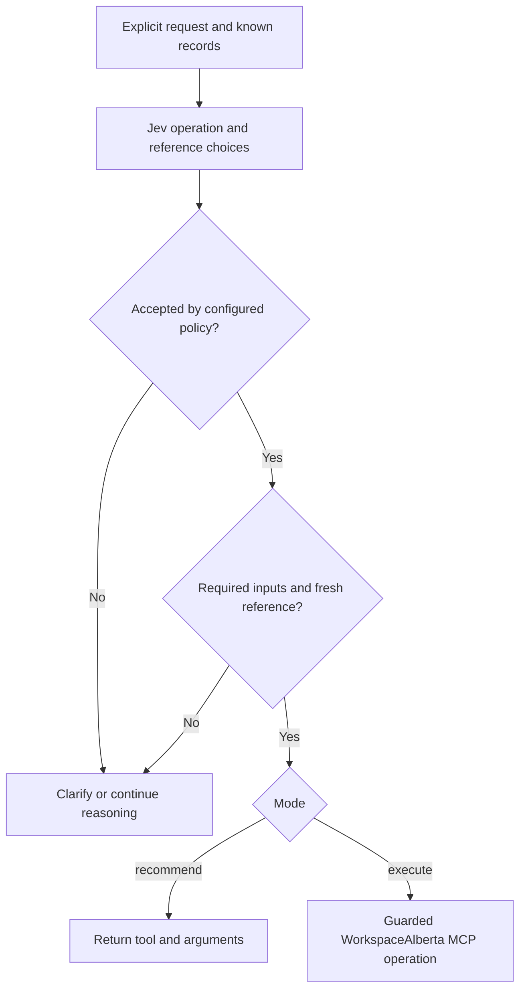

# Agent Note: Jev decisions for WorkspaceAlberta

Status: implemented

English | [中文](2026-09-19-jev-workspace-decisions.zh.md)

## Problem

WorkspaceAlberta owns procurement retrieval and document analysis; the harness owns conversation and guarded tool execution. Natural-language requests need a bounded operation choice without moving business routing into the agent loop or letting a classifier invent tender identifiers.

## Decision

The [Workspace router plugin](../../../../packages/workspace/workspace-router/README.md) adds an explicit `workspace_route` tool. Jev answers typed Choice questions; deterministic code chooses recommendation, execution, clarification or ordinary reasoning. The project-local [TypeSafe skill](../../../skills/typesafe-ai/SKILL.md) supplies the [intent-routing pattern](https://docs.typesafe.ai/patterns/intent-routing) and [candidate-selection pattern](https://docs.typesafe.ai/cookbooks/function_calling). The skill is retained locally with its MIT license.

Operation and reference questions share one inference request, but unused speculative answers cannot invalidate an unrelated branch. Input validation, probability validation, explicit per-operation thresholds and reference-age rules precede dispatch. Identifiers and business facts come from supplied state. Uncertain and compound requests stay with the reasoning model. Recommendation is the default; thresholds have no production defaults.

One plugin consumes the TypeSafe SDK and existing credential/tool services. It does not introduce a general decision service: there is one fixed question set and one workflow owner, with no independently evolving providers or Consumers. The [ToolRuntime](../../../../packages/core/tools/README.md) remains authoritative for guards, approval, cancellation and child execution. No WorkspaceAlberta server behavior or agent-loop hook changes.

Auxiliary model input must be reconstructable. The `workspace/route` event records the secret-free request and policy, relevant validated answers and decision, and settled child result in that order. Its companion invariant checks the actual session stream. Cancellation aborts inference and plugin disposal drains active calls. A child result exceeding the output limit records possible completion because retrying a side effect is not automatically safe.

## Integration

The current corporate deployment mounts `@workspacealberta/wa-workspace-router` in recommendation mode alongside native Cohere v2 and `project-tools`. Jev is pinned to `jev-1.14.0` through SDK 0.7. API probabilities retain two-decimal rounding. The deployment threshold of 0.9 is provisional review policy, not calibrated authority. Existing generic profiles do not mount the router automatically.

## Alternatives considered

**Put routing inside the MCP.** Procurement-specific judgments belong in the shared WorkspaceAlberta service, but it does not own the harness conversation. This implementation selects among its existing operations. Semantic tender-fit and mandatory-condition scoring remain separate, unimplemented service work.

**Replace the reasoning model with Jev.** Typed judgments suit bounded choices; explanations, coding and compound plans still require the existing model.

**Automatically intercept every turn.** An explicit tool keeps activation visible and avoids silently adding inference to unrelated tasks. An automatic hook needs separate evaluation and policy.

## Consequences

The deployment gains a bounded route with logged evidence and preserves tool policy. It also adds one external inference request and its latency, cost and data processing. Caller-supplied state and retrieval times remain a trust assumption. A typed answer constrains representation, not truth; confidence is not authorization. The package is included in the base bundle for optional composition and does not establish exactly-once delivery across MCP retries.

Keyless unit tests cover branch selection, malformed responses, budgets, guard denial and cancellation. A recorded CLI scenario exercises the routing tool under native Cohere with deterministic auxiliary inference. Keyless tests cover all five branches and guarded dispatch. SDK projection tests preserve the auxiliary event. Live Jev accuracy, fallback frequency, latency and cost require labeled deployment evaluation before enabling dispatch; no such measurement is claimed.

The separate [business-planning proposal](../../proposed/feature/2026-09-19-jev-business-planning.md) applies evidence selection and verification to connected business records; it does not replace this routing decision.
