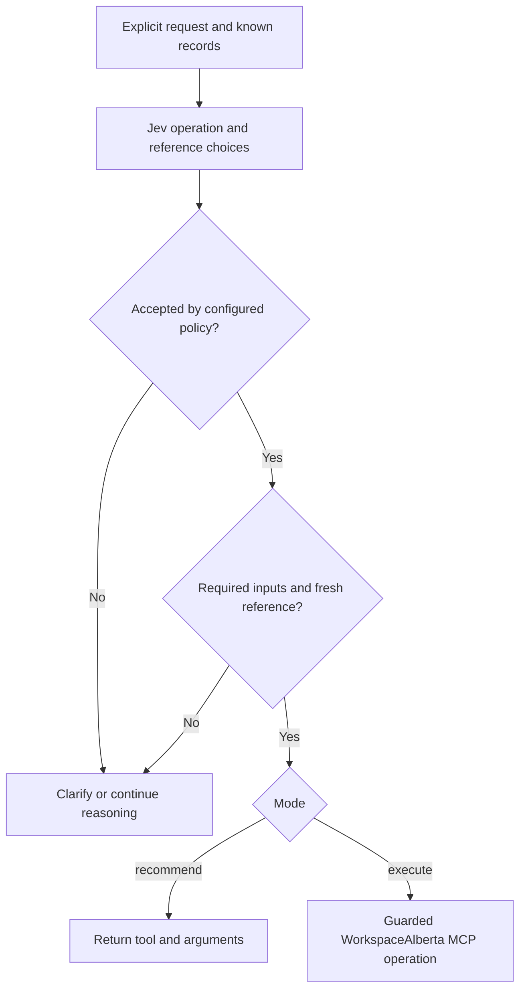

# Agent Note: Jev decisions for WorkspaceAlberta

Status: implemented

[English](2026-09-19-jev-workspace-decisions.md) | 中文

## 问题

WorkspaceAlberta 负责采购检索和文档分析；Harness 负责会话及受保护的工具执行。自然语言请求需要有限范围内的操作选择，既不能将业务路由放入智能体循环，也不能让分类器编造招标编号。

## 决策

私有的 [Workspace 路由器插件](../../../../packages/experimental/workspace-router/README.md) 添加显式的 `workspace_route` 工具。Jev 回答类型化 Choice 问题；确定性代码选择建议、执行、澄清或常规推理。项目内的 [TypeSafe 技能](../../../skills/typesafe-ai/SKILL.md) 提供[意图路由模式](https://docs.typesafe.ai/patterns/intent-routing)和[候选选择模式](https://docs.typesafe.ai/cookbooks/function_calling)。Codex 仅通过一种方式安装该技能：`npx skills add typesafe-ai/skills --skill typesafe-ai --agent codex --yes`。

操作和编号问题共享一次推理请求，但未使用的推测分支答案不会使无关分支失效。分派前执行输入验证、概率验证、明确的分操作阈值检查以及编号时效检查。编号和企业事实来自提供的状态。不确定和复合请求留给推理模型。默认模式为建议；阈值没有生产默认值。

一个插件消费 TypeSafe SDK 和现有凭据、工具服务。它不引入通用决策服务：这里仅有一组固定问题和一个工作流所有者，没有独立演进的提供方或消费方。[ToolRuntime](../../../../packages/core/tools/README.md) 仍负责守卫、审批、取消和子工具执行。WorkspaceAlberta 服务器行为与智能体循环钩子均不改变。

辅助模型输入必须可重建。`workspace/route` 事件依次记录不含凭据的请求和策略、相关且经过验证的答案和决策，以及已结束的子工具结果。伴随不变量检查实际会话事件流。取消会中止推理，插件卸载会等待在途调用结束。子工具结果超出输出限制时会记录可能已完成，因为副作用不能默认安全重试。

## 考虑过的替代方案

**在 MCP 内部进行路由。** 采购专属判断属于共享的 WorkspaceAlberta 服务，但该服务不拥有 Harness 会话。此实现仅从已有操作中选择。招标语义匹配和强制条件评分仍是独立且未实现的服务工作。

**用 Jev 替换推理模型。** 类型化判断适合有限选择；解释、编程和复合计划仍需要现有模型。

**自动拦截每个回合。** 显式工具使启用行为可见，避免悄然为无关任务增加推理调用。自动钩子需要独立的评估和策略。

## 影响

部署获得有限范围的路由及日志证据，并保留工具策略；同时增加一次外部推理请求及其延迟、成本和数据处理。调用方提供的状态与检索时间仍是信任假设。类型化答案约束表示形式，不保证真实性；置信度不代表授权。此私有包排除在正式发行之外，也不保证跨 MCP 重试的仅一次交付。

无密钥单元测试覆盖分支选择、格式错误的响应、预算、守卫拒绝和取消。真实 Loader 组合通过 MCP 桥接对五条路由及回退、澄清结果生成快照；仅外部服务由夹具替代。SDK 投影测试保留辅助事件。启用分派前，需要通过已标注的部署样本评估真实 Jev 的准确率、回退频率、延迟和成本；本文不声称已获得这些测量结果。

独立的[商业规划提案](../../proposed/feature/2026-09-19-jev-business-planning.md)将证据选择与核验用于已连接的经营记录，不替代此路由决策。
